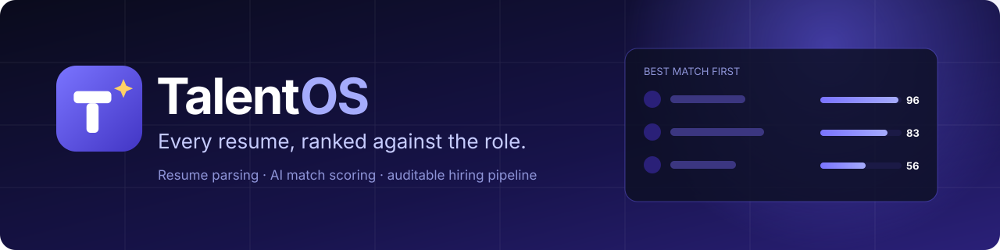
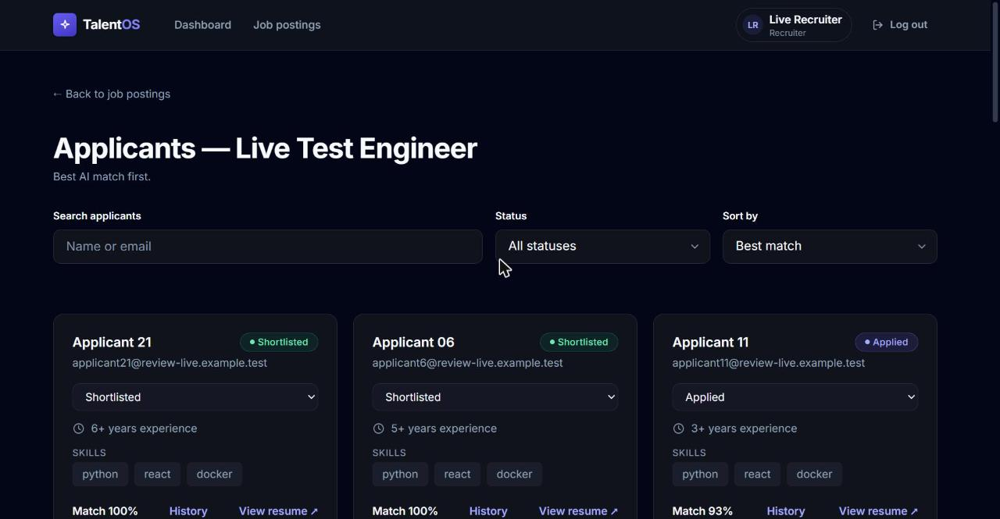
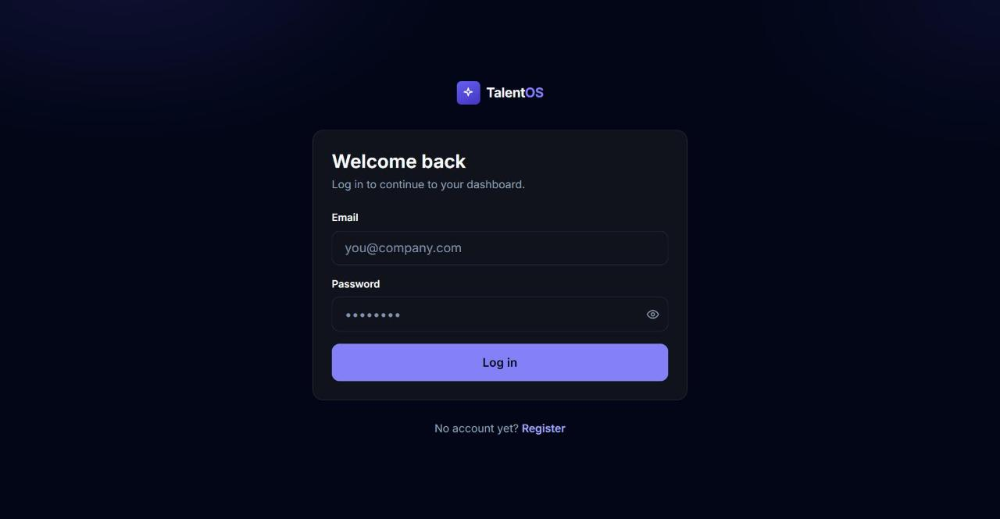
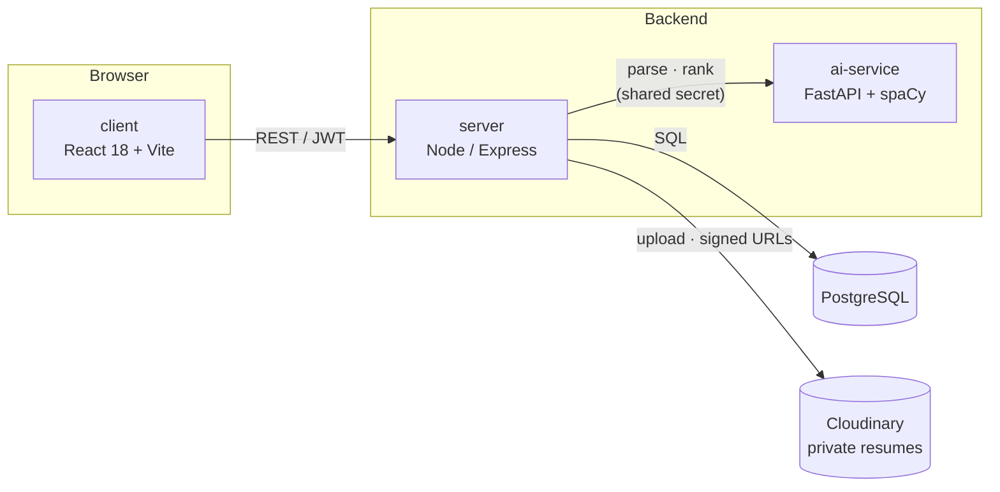

<div align="center">



<br />


# TalentOS

**Every resume, ranked against the role.**

An AI-assisted applicant tracking system: candidates apply with a resume, TalentOS parses it and scores it against the job's requirements, and recruiters work a ranked, auditable hiring pipeline.

[](https://github.com/Slv-WebTech/talentos/actions/workflows/ci.yml)


[Features](#-features) · [Architecture](#-architecture) · [Quick start](#-quick-start) · [API](#-api-overview) · [Testing](#-testing) · [Security](#-security) · [Roadmap](#-roadmap) · [Docs](#-documentation)

</div>

---

## ✨ Features

| | |
|---|---|
| 🔐 **Role-based access** | Recruiters and candidates self-register; admins are provisioned with a script. JWT auth, bcrypt hashing, and the account is re-checked on every request, so deleted or demoted users lose access immediately. |
| 📝 **Job postings** | Create, edit and close jobs with required skills, minimum experience, salary range and location. Validated server-side; closed jobs are hidden from candidates. |
| 📄 **Resume upload** | PDF / DOCX (legacy DOC accepted, not parsed). Magic-byte checks, 5 MB limit, files stored **privately** on Cloudinary and opened through 5-minute signed links. |
| 🤖 **AI parsing** | A FastAPI service extracts name, email, phone, skills, experience and education with spaCy + rules. Parse failures never block an application. |
| 🎯 **Match scoring** | Each applicant gets a 0–100 score: 70 % skill overlap (parsed skills **or** whole-word matches in the resume text) + 30 % experience fit. Scores refresh automatically when a job's criteria change. |
| 🧭 **Hiring pipeline** | Applied → Shortlisted → Interview → Selected / Rejected with enforced transitions, confirmation on final outcomes, and a full audit trail (who, when). |
| 🔎 **Recruiter workspace** | Ranked applicant list with search, status filter, sort and pagination; per-candidate history; one-click re-score. |
| ♿ **Premium, accessible UI** | CSS-Modules design system, dark theme, responsive down to 375 px, WCAG-AA contrast, keyboard-friendly, skip link, live-region feedback. |

<details>
<summary><b>Screenshots</b></summary>

| Recruiter — ranked applicants | Login |
|---|---|
|  |  |

*Screenshots use synthetic demo data only.*
</details>

## 🏗 Architecture



```
talentos/
├── client/        React app (pages, ui components, services, design tokens, Vitest tests)
├── server/        Express API (routes → controllers → models, services, middleware, migrations, tests)
├── ai-service/    FastAPI: /parse-resume, /rank (ranking.py, skills_extractor.py, pytest tests)
├── assets/        Logo, banner, favicon, social-preview artwork
├── docs/          Architecture, decisions, plan, QA report, changelog
└── .github/       CI workflow, PR / issue templates, CODEOWNERS
```

The browser never talks to the AI service: every call is proxied by the authenticated API.

## 🚀 Quick start

**Requirements:** Node 20+ (22 recommended), Python 3.11+, PostgreSQL 14+ (or Docker), optional Cloudinary account for resume uploads.

```bash
# 1. Database (optional: Docker)
docker compose up -d            # postgres on :5432  (user/password/db: talentos/talentos/ats)

# 2. API
cd server
cp .env.example .env            # then fill in the values (see table below)
npm install
npm run migrate                 # applies server/db/migrations/*.sql
npm run dev                     # http://localhost:5000

# 3. AI service
cd ../ai-service
python -m venv venv
venv/Scripts/pip install -r requirements.txt     # venv/bin/pip on macOS / Linux
venv/Scripts/python -m uvicorn main:app --reload --port 8000

# 4. Client
cd ../client
npm install
npm run dev                     # http://localhost:5173
```

Create an admin account when you need one:

```bash
cd server
ADMIN_EMAIL=you@company.com ADMIN_PASSWORD='at-least-12-characters' npm run create-admin
```

### Configuration (`server/.env`)

| Variable | Required | Description |
|---|---|---|
| `DATABASE_URL` | ✅ | PostgreSQL connection string |
| `JWT_SECRET` | ✅ | ≥ 32 random characters; the server refuses to start with a weak value |
| `CLIENT_URL` | ✅ | Allowed CORS origin (default `http://localhost:5173`) |
| `AI_SERVICE_URL` | ✅ | Base URL of the AI service (default `http://localhost:8000`) |
| `AI_SERVICE_SECRET` | recommended | Shared secret sent as `X-Internal-Secret`; set the same value in the AI service environment |
| `CLOUDINARY_CLOUD_NAME` / `_API_KEY` / `_API_SECRET` | for uploads | Resume storage; without them applying returns a clear 503 |
| `PORT` | – | API port (default `5000`) |
| `JWT_EXPIRES_IN` | – | Token lifetime (default `7d`) |
| `TRUST_PROXY` | behind a proxy | Number of proxy hops so rate limiting sees real client IPs |
| `AUTH_RATE_LIMIT` / `REGISTER_RATE_LIMIT` / `API_RATE_LIMIT` | – | Limiter tuning |

Client: `VITE_SERVER_URL` (default `http://localhost:5000`). Generate a secret with  
`node -e "console.log(require('crypto').randomBytes(48).toString('hex'))"`.

## 🔌 API overview

All routes except `register`, `login` and `health` need `Authorization: Bearer <token>`. Responses use `{ data }`, `{ data, meta: { limit, offset, hasMore } }` or `{ error: { message } }`.

| Method & path | Role | Purpose |
|---|---|---|
| `POST /api/auth/register` · `POST /api/auth/login` · `GET /api/auth/me` | public / any | Accounts and session |
| `GET /api/jobs` (`?recruiter=me`, `limit`, `offset`) · `GET /api/jobs/:id` | any | Browse jobs (closed jobs only for their owner) |
| `POST /api/jobs` · `PUT /api/jobs/:id` | recruiter (owner) | Create / edit / close; criteria edits trigger a background re-score |
| `POST /api/applications` (multipart `jobId`, `resume`) | candidate | Apply: upload → parse → score |
| `GET /api/applications?candidate=me` | candidate | My applications |
| `GET /api/applications?job=:id` (`q`, `status`, `sort=score\|newest`, paging) | recruiter (owner) | Ranked applicants |
| `PATCH /api/applications/:id/status` · `GET /api/applications/:id/history` | recruiter (owner) | Pipeline moves and audit trail |
| `GET /api/applications/:id/resume-url` | candidate / recruiter (owner) | 5-minute signed resume link |
| `POST /api/applications/rerank?job=:id` | recruiter (owner) | Re-score all applicants |
| `GET /api/health` | public | Liveness |

AI service (internal): `POST /parse-resume`, `POST /rank`, `GET /health`.

## 🧪 Testing

```bash
cd server    && npm test                  # 24 route/middleware tests (no DB needed)
cd server    && npm run test:integration  # 3 real-Postgres tests in a throw-away schema
cd ai-service && python -m pytest tests   # 15 parser / ranking tests
cd client    && npm test && npm run build # 12 component/service tests + production build
```

GitHub Actions runs all of the above on every PR (`.github/workflows/ci.yml`). Not yet covered: browser E2E and a real Cloudinary account — see [`docs/TESTING.md`](docs/TESTING.md).

## 🛡 Security

- Helmet headers, CORS locked to `CLIENT_URL`, 100 kB JSON limit, parameterised SQL, strict id / pagination / field validation.
- bcrypt passwords; JWT verified **and** the user re-read from the DB on each request (deleted users 401, DB role wins).
- Rate limits: failed logins only (so shared NATs aren't locked out), hourly registration cap, general API cap.
- Resumes stored as private Cloudinary assets; signed links expire after 5 minutes; list APIs never expose file URLs.
- Uploads validated by extension **and** file signature; AI service protected by a shared secret.
- Secrets live in `.env` (git-ignored); only `.env.example` with placeholders is tracked.

Open risks (tracked in [`docs/QA-REPORT.md`](docs/QA-REPORT.md)): JWT is kept in `localStorage`, there is no refresh-token flow, registration reveals whether an email exists, and offset pagination can shift under concurrent writes. Report vulnerabilities privately via GitHub security advisories.

## 🗺 Roadmap

- [x] Auth, job postings, resume upload, AI parsing
- [x] Match scoring, ranked applicants, pipeline with history, search / filter / sort
- [x] Security hardening, automated tests, CI
- [ ] Interview scheduling and notifications
- [ ] Hiring analytics dashboard and exports
- [ ] Embedding-based semantic matching (sentence-transformers)
- [ ] Admin console (users, moderation)
- [ ] Refresh tokens / httpOnly cookie sessions, browser E2E tests

## 📚 Documentation

Start at [`docs/README.md`](docs/README.md): [architecture](docs/ARCHITECTURE.md) · [decisions](docs/DECISIONS.md) · [plan](docs/PROJECT_PLAN.md) · [QA report](docs/QA-REPORT.md) · [deployment](docs/DEPLOYMENT.md) · [changelog](docs/CHANGELOG.md) · [tech debt](docs/TECHNICAL_DEBT.md).

## 📄 Licence

Proprietary — all rights reserved. No licence is granted to use, copy or distribute this code without the owner's written permission. (Add a `LICENSE` file if the project is opened up.)

<div align="center"><sub>Built with care · <b>TalentOS</b> — every resume, ranked against the role.</sub></div>
