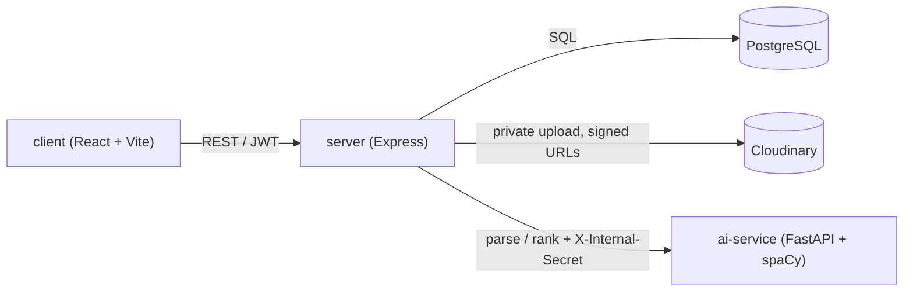

# Architecture

Status: **implemented** for the auth → job → resume → score → pipeline slice; interviews, analytics and an admin console remain planned ([[PROJECT_PLAN]]).

## Overview
Three independently runnable services plus PostgreSQL and Cloudinary:



## Frontend (`client/`)
- React 18 + Vite; routes in `src/App.jsx` with a `ProtectedRoute` role guard; pages in `src/pages`, design system in `src/components/ui`, layout in `src/components/layout`, tokens in `src/styles/tokens.css` (dark theme via `prefers-color-scheme`).
- `src/services/*` are the only place that call the API (`apiClient.js` exposes `apiRequest` and `apiRequestPage` for paginated endpoints).
- Tests: Vitest + Testing Library (`*.test.js(x)` next to the code).

## Backend (`server/`)
- `routes/` → `controllers/` → `models/` (SQL only) with `services/` for outbound integrations (`uploadService` Cloudinary, `aiServiceClient`, `rankingService`) and `middleware/` (`authMiddleware`, `rateLimiters`, `uploadMiddleware`, `errorHandler`). `utils/ids.js` and `utils/pagination.js` centralise input hardening.
- `server.js` exports the Express app (so tests can mount it) and only listens when run directly; it validates `JWT_SECRET` at startup.
- Migrations: plain SQL in `db/migrations`, applied by `npm run migrate` (tracked in `schema_migrations`).

## Data model
| Table | Key columns |
|---|---|
| `users` | `id`, `name`, `email` (unique, compared case-insensitively), `password_hash`, `role` (`admin`/`recruiter`/`candidate`) |
| `jobs` | `recruiter_id`, `title`, `department`, `required_skills TEXT[]`, `min_experience_years`, `salary_min/max`, `location`, `status` (`open`/`closed`); index `(status, created_at DESC)` |
| `applications` | `job_id`, `candidate_id` (unique pair), `resume_url` (legacy), `resume_public_id` (private Cloudinary id), `resume_text` (full text for scoring, never returned by list APIs), `parsed_data JSONB`, `ranking_score`, `ranking_details JSONB`, `pipeline_status`; index `(job_id, ranking_score DESC)` |
| `application_status_history` | `application_id`, `from_status`, `to_status`, `changed_by`, `created_at` |

## AI service (`ai-service/`)
- `POST /parse-resume` → `{ data: {name,email,phone,skills,experienceYears,education}, text }` (pdfplumber / python-docx + spaCy NER + regex; contextual matching avoids false positives like "go the extra mile").
- `POST /rank` → deterministic 0–100 score: 70 % skill overlap (parsed skills **or** whole-word match in the resume text) + 30 % experience fit; weights re-normalise over the criteria a job actually sets.
- Both endpoints require `X-Internal-Secret` when `AI_SERVICE_SECRET` is set. Embedding-based matching is a roadmap item, not built.

## Authentication & authorization
- bcrypt password hashes; JWT carries only `id` and `role`.
- `verifyToken` verifies the signature **and re-reads the user** on every request: deleted users get 401 and the database role replaces the token's role claim.
- Role checks via `requireRole`; resource ownership checked in controllers (job owner for applicants, status, history, re-rank; candidate or job owner for resume links).
- Rate limits: failed-login limiter, hourly registration limiter, general API limiter.

## Core flows
1. **Apply:** client → `POST /api/applications` → validate file (type, size, signature) → store privately in Cloudinary → ai-service parse → ai-service rank → insert application (409 on duplicate, uploaded file cleaned up on failure).
2. **Review:** recruiter lists applicants (`q`, `status`, `sort`, paging), opens resumes via 5-minute signed URLs, moves candidates through the pipeline (rules below, each move audited).
3. **Re-score:** editing a job's skills / experience triggers a background re-rank (5 concurrent workers); "Re-score all" does the same on demand.

Pipeline transitions: applied → shortlisted/rejected · shortlisted → applied/interview/rejected · interview → shortlisted/selected/rejected · selected → interview · rejected → applied/shortlisted.

## Security boundaries
- The client never calls the AI service; all AI calls are proxied by the authenticated API.
- Candidate PII is only readable by the recruiter who owns the job (and the candidate themself).
- Secrets only in `server/.env` (git-ignored); `.env.example` holds placeholders.

## Folder structure
```
talentos/
├── client/       src/{pages,components,services,styles}, public/ (favicons, og-image)
├── server/       {routes,controllers,models,services,middleware,utils,config,db,test}
├── ai-service/   main.py, resume_parser.py, skills_extractor.py, ranking.py, tests/
├── assets/       logo, banner, favicon, social preview
├── docs/         this folder
└── .github/      workflows, PR + issue templates, CODEOWNERS
```
